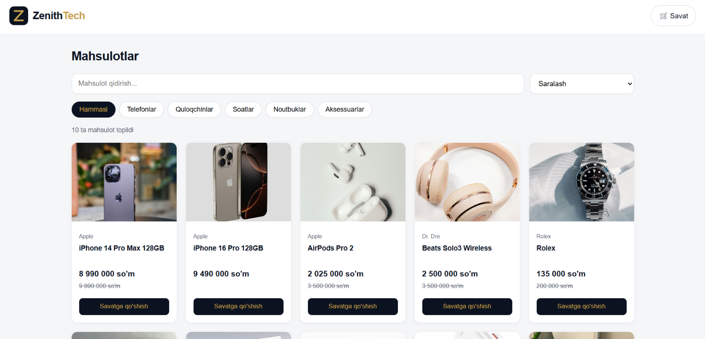

# ⚡ ZenithTech

### Electronics & gadgets store, built from scratch with pure JavaScript.

*No frameworks. No backend. Just clean code and a marketplace-grade shopping experience.*

 

 

 

## ✨ Why ZenithTech?

Big marketplaces like **Uzum Market** and **Wildberries** feel effortless to use, and that is hard to build. ZenithTech is my take on the **frontend side** of that experience: browsing, finding, comparing and buying products, all running in the browser with zero dependencies.

> 🎯 **Goal:** prove that a polished, full shopping flow is possible with fundamentals alone: HTML, CSS and vanilla JavaScript.

 

## 🛍️ Features

| | Feature | What it does |
|---|---|---|
| 🗂️ | **Dynamic catalog** | Products are loaded from `data/products.json` and rendered as cards with JavaScript |
| 🔎 | **Smart search** | Find products instantly as you type |
| 🏷️ | **Category filter** | Narrow the catalog down to what you need |
| ↕️ | **Sorting** | Order products to find the best fit |
| 📄 | **Product page** | Dedicated detail page for every item (`product.html?id=…`) |
| 🛒 | **Persistent cart** | Your cart survives page reloads thanks to `localStorage` |
| 💳 | **Checkout flow** | Form with validation and an order confirmation screen |

 

## 🧭 How it works

mermaid
flowchart LR
    A[📦 products.json] --> B[⚙️ main.js]
    B --> C[🗂️ Product cards]
    C --> D[📄 Product page]
    C --> E[🛒 Cart]
    D --> E
    E --> F[💾 localStorage]
    E --> G[💳 Checkout]
    G --> H[✅ Order confirmed]

 

## 🧱 Tech Stack

| Layer | Technology |
|---|---|
| Structure | HTML5 (semantic markup) |
| Styling | CSS3 (custom styles, no UI libraries) |
| Logic | Vanilla JavaScript (ES6+, `fetch`, `localStorage`) |
| Data | Static JSON |
| Hosting | Vercel |

 

## 📁 Project Structure

text
Zenith Tech/
├── 📄 index.html          # Home: catalog, search, filters
├── 📄 product.html        # Product detail page
├── 📄 cart.html           # Cart & checkout
├── 🎨 css/                # Stylesheets
├── ⚙️ js/                 # main.js and cart logic
├── 📦 data/
│   └── products.json      # Product database
└── 🖼️ images/             # Logo and product photos

 

## 🚀 Quick Start

bash
# 1. Clone the repo
git clone https://github.com/Samirjon018/ZeinthTech

# 2. Enter the folder
cd zenith-tech

# 3. Start a local server (products load via fetch)
npx serve

Then open the address shown in your terminal.

> 💡 **Tip:** in VS Code you can also right-click `index.html` and choose **Open with Live Server**.

 

## 🗺️ Roadmap

- [x] Product catalog from JSON
- [x] Search, category filter and sorting
- [x] Product detail page
- [x] Cart with `localStorage`
- [x] Checkout with form validation
- [x] Deployed on Vercel
- [ ] ❤️ Favorites (wishlist)
- [ ] 🔐 User accounts
- [ ] 🧾 Backend and real orders

 

## 💡 What I learned

- Structuring a multi-page project with a clean folder architecture
- Rendering UI from data with the DOM API
- Managing state (the cart) without a framework
- Validating forms and designing a checkout flow
- Shipping a project end to end: Git, GitHub and Vercel deployment

 

---

### 👨‍💻 Built by **Samirjon Abdurakhimov**

Web development student at One World Academy, Samarkand

 

⭐ *If you liked this project, a star on the repo means a lot!*

